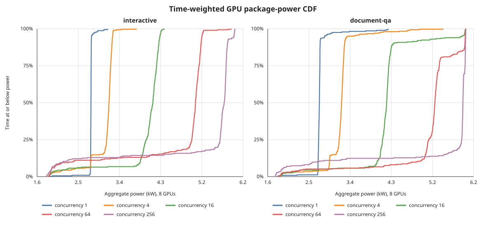

# Power analysis on 8× MI300X

## openai/gpt-oss-120b

All 24 measurements completed without failed requests. Power is the sum of the
eight GPU package readings, not whole-node wall power. `% TDP` uses AMD SMI's
reported 750 W maximum package power per GPU (6.0 kW total) as a proxy.

### Overview

| Run | ISL/OSL | Conc | Time | Out tok/s | Avg W | Max sampled W | TDP % |
|:---|---:|---:|---:|---:|---:|---:|---:|
| decode-heavy-i8192-o8192-c1 | 8192/8192 | 1 | 221.16s | 148.2 | 2,759.9 | 2,778.0 | 46.0% |
| decode-heavy-i8192-o8192-c4 | 8192/8192 | 4 | 146.65s | 446.9 | 3,200.2 | 3,332.0 | 53.3% |
| decode-heavy-i8192-o8192-c16 | 8192/8192 | 16 | 160.23s | 1,636.1 | 4,149.9 | 4,394.0 | 69.2% |
| decode-heavy-i8192-o8192-c32 | 8192/8192 | 32 | 176.51s | 2,970.3 | 4,708.6 | 4,988.0 | 78.5% |
| document-qa-i8192-o1024-c1 | 8192/1024 | 1 | 70.07s | 146.1 | 2,746.2 | 4,258.0 | 45.8% |
| document-qa-i8192-o1024-c4 | 8192/1024 | 4 | 75.49s | 406.9 | 3,196.0 | 5,482.0 | 53.3% |
| document-qa-i8192-o1024-c16 | 8192/1024 | 16 | 78.61s | 1,432.9 | 4,222.5 | 5,981.0 | 70.4% |
| document-qa-i8192-o1024-c64 | 8192/1024 | 64 | 84.25s | 3,682.7 | 5,177.0 | 5,988.0 | 86.3% |
| document-qa-i8192-o1024-c256 | 8192/1024 | 256 | 69.98s | 7,491.9 | 5,450.0 | 5,995.0 | 90.8% |
| interactive-i1024-o1024-c1 | 1024/1024 | 1 | 68.89s | 148.6 | 2,771.2 | 3,143.0 | 46.2% |
| interactive-i1024-o1024-c4 | 1024/1024 | 4 | 74.87s | 396.6 | 3,083.4 | 3,784.0 | 51.4% |
| interactive-i1024-o1024-c16 | 1024/1024 | 16 | 72.20s | 1,574.2 | 4,003.0 | 4,407.0 | 66.7% |
| interactive-i1024-o1024-c64 | 1024/1024 | 64 | 72.02s | 4,293.8 | 4,711.6 | 5,903.0 | 78.5% |
| interactive-i1024-o1024-c256 | 1024/1024 | 256 | 68.89s | 11,013.8 | 5,210.3 | 5,984.0 | 86.8% |
| large-kv-32k-i32768-o2048-c1 | 32768/2048 | 1 | 72.62s | 141.0 | 2,773.0 | 5,808.0 | 46.2% |
| large-kv-32k-i32768-o2048-c4 | 32768/2048 | 4 | 79.98s | 384.1 | 3,360.0 | 5,955.0 | 56.0% |
| large-kv-32k-i32768-o2048-c8 | 32768/2048 | 8 | 80.75s | 710.1 | 3,829.0 | 5,952.0 | 63.8% |
| large-kv-32k-i32768-o2048-c16 | 32768/2048 | 16 | 91.06s | 1,147.1 | 4,231.5 | 5,970.0 | 70.5% |
| large-kv-64k-i65536-o4096-c1 | 65536/4096 | 1 | 116.08s | 141.1 | 2,879.6 | 5,953.0 | 48.0% |
| large-kv-64k-i65536-o4096-c4 | 65536/4096 | 4 | 80.92s | 404.9 | 3,461.7 | 5,975.0 | 57.7% |
| large-kv-64k-i65536-o4096-c8 | 65536/4096 | 8 | 86.35s | 758.9 | 4,033.0 | 5,973.0 | 67.2% |
| large-kv-64k-i65536-o4096-c16 | 65536/4096 | 16 | 103.97s | 1,260.6 | 4,665.9 | 5,986.0 | 77.8% |
| smoke-i256-o128-c1 | 256/128 | 1 | 43.69s | 146.5 | 2,790.9 | 2,982.0 | 46.5% |
| smoke-i256-o128-c4 | 256/128 | 4 | 44.82s | 419.8 | 3,197.0 | 3,824.0 | 53.3% |

### Time-weighted power CDF

For any power value on the X-axis, the Y-axis is the percentage of benchmark
time spent at or below it. A curve farther right means more sustained high
power; a brief maximum has little effect on most of the curve.

### Power conclusions

- **Batching improves power utilization.** Interactive c64→c256 raises
  throughput 156.5% while average power rises 10.6%. Document-QA throughput
  rises 103.4% for 5.3% more power. More concurrent tokens amortize model-weight
  traffic and keep compute, HBM, and the tensor-parallel fabric busier.
- **High concurrency sustains near-limit power.** At c256, median power is
  5.75 kW for interactive and 5.93 kW for document-QA; their 90th percentiles
  are 5.82 and 5.98 kW. The right-shifted CDF curves show this is sustained,
  not just a momentary spike.
- **Maximum power alone is misleading.** Large-KV c1 briefly reaches
  5.81–5.95 kW during prompt processing, but averages only 2.77–2.88 kW. Its
  long decode phase runs much lower, so the brief prefill peak barely affects
  average power.
- **Decode-heavy c32 is genuinely high-power decode.** Its middle 80% of power
  samples lies around 4.60–4.86 kW, while median TTFT is only 0.67 s within a
  176.5 s run. Prefill/decode overlap is therefore not the main cause: batching
  32 decode tokens turns small operations into more efficient matrix work and
  raises sustained package utilization.
- **Low concurrency leaves substantial headroom.** Across short, interactive,
  document, and decode-heavy workloads, c1 averages about 2.75–2.88 kW, or
  46–48% of the 6.0 kW proxy TDP. The model is resident on all eight GPUs, but
  too little work is in flight to use the available power envelope.

[Combined text analysis](results/openai--gpt-oss-120b/20260730-025816Z/combined-analysis.txt) · [22-point baseline](results/openai--gpt-oss-120b/20260730-001049Z/) · [c256 follow-up](results/openai--gpt-oss-120b/20260730-025816Z/)

## MiniMaxAI/MiniMax-M3-MXFP8

Interim snapshot: 11 of 24 planned measurements are complete. The live suite
is continuing with `document-qa-i8192-o1024-c256`; incomplete points are not
failures and are omitted from this table. Power is the sum of the eight GPU
package readings. `% TDP` uses AMD SMI's reported 750 W maximum package power
per GPU (6.0 kW total) as a proxy.

### Overview

| Run | ISL/OSL | Conc | Time | Out tok/s | Avg W | Max sampled W | TDP % |
|:---|---:|---:|---:|---:|---:|---:|---:|
| document-qa-i8192-o1024-c1 | 8192/1024 | 1 | 79.24s | 90.5 | 3,556.4 | 5,852.0 | 59.3% |
| document-qa-i8192-o1024-c4 | 8192/1024 | 4 | 80.09s | 294.1 | 4,772.5 | 5,959.0 | 79.5% |
| document-qa-i8192-o1024-c16 | 8192/1024 | 16 | 87.92s | 652.2 | 5,629.6 | 5,973.0 | 93.8% |
| document-qa-i8192-o1024-c64 | 8192/1024 | 64 | 119.53s | 1,096.6 | 5,959.9 | 6,008.0 | 99.3% |
| interactive-i1024-o1024-c1 | 1024/1024 | 1 | 76.44s | 93.8 | 3,543.8 | 4,721.0 | 59.1% |
| interactive-i1024-o1024-c4 | 1024/1024 | 4 | 73.20s | 321.8 | 4,720.5 | 5,558.0 | 78.7% |
| interactive-i1024-o1024-c16 | 1024/1024 | 16 | 74.38s | 812.3 | 5,718.6 | 5,981.0 | 95.3% |
| interactive-i1024-o1024-c64 | 1024/1024 | 64 | 86.06s | 1,523.0 | 5,963.2 | 6,009.0 | 99.4% |
| interactive-i1024-o1024-c256 | 1024/1024 | 256 | 139.60s | 3,755.8 | 5,971.1 | 6,007.0 | 99.5% |
| smoke-i256-o128-c1 | 256/128 | 1 | 70.34s | 89.2 | 3,625.6 | 4,028.0 | 60.4% |
| smoke-i256-o128-c4 | 256/128 | 4 | 57.07s | 298.3 | 4,611.6 | 5,188.0 | 76.9% |

[Current MiniMax results](results/MiniMaxAI--MiniMax-M3-MXFP8/20260730-055304Z/)
