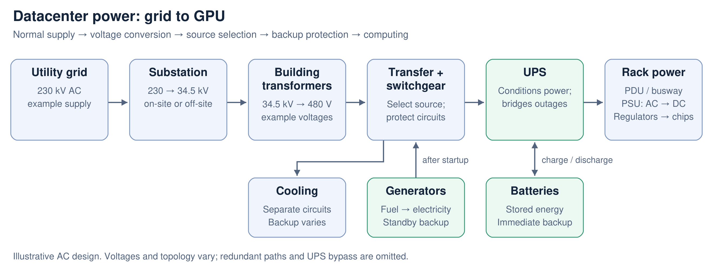
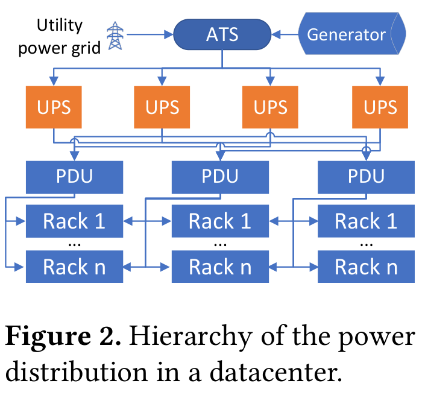

# Datacenter power: from the grid to the GPU

*A short introduction, checked against public sources on October 25, 2026.*

**Four different jobs:** power plants generate electricity; substations change voltage and connect circuits; UPS systems bridge interruptions; servers consume electricity. “On-site” describes location. “Off-grid” describes the electrical connection.

Here, **datacenter** means the facility. **DC electricity** means direct current; **AC** means alternating current. A datacenter is not necessarily powered by DC throughout.

## 1. Follow the electricity

This is an illustrative large-campus AC design. Voltages are examples, not universal requirements. Smaller sites may receive medium-voltage power directly from an off-site utility substation.

[Scalable diagram (SVG)](assets/datacenter-power-flow.svg)

Real sites repeat these paths for redundancy. Generator connections and transfer equipment can sit at other voltage levels; some facilities distribute batteries to racks. Cooling has its own backup design and is not necessarily on the IT UPS. [PNNL/DOE architecture reference, §2](https://www.energy.gov/sites/default/files/2026-01/Data_Center_EMT_Models.pdf)

| Piece | What it does |
|---|---|
| **Substation / transformer** | Changes voltage. High-voltage delivery carries the same power with less current and lower resistive losses. It does not create electricity. |
| **Switchgear / breakers** | Connect, isolate, and protect circuits. Switchgear itself does not change voltage. |
| **ATS: automatic transfer switch** | Selects a power source. It neither stores energy nor generates it. |
| **UPS + batteries** | Keeps the protected load powered during an interruption. The UPS includes power electronics; it is more than a battery. |
| **Generator** | Converts fuel into electricity for longer backup operation. It needs startup time and fuel availability. |
| **PDU: power distribution unit / busway** | Splits and routes power toward racks. A facility PDU and a rack outlet strip are different scales of distribution. |
| **PSU: power supply unit** | Converts incoming power to DC; board regulators then supply the voltages chips need. |

### From one power path to many racks

The compact diagram above follows the equipment along one path. The POLCA figure below zooms out to show **how power branches across a datacenter**, including alternative supply paths.

*Source: Patel et al., [Characterizing Power Management Opportunities for LLMs in the Cloud, ASPLOS 2024, Figure 2](https://www.microsoft.com/en-us/research/uploads/prod/2024/03/GPU_Power_ASPLOS_24.pdf#page=2).*

Read it from top to bottom:

1. **Utility + generator → ATS:** the transfer switch selects the supply. Substations and transformers are omitted here; they still perform the voltage conversions shown in the first diagram.
2. **ATS → several UPS units:** these are separate branches serving groups of loads, not four UPS stages that electricity passes through in sequence.
3. **UPS units → PDUs:** the lines illustrate multiple supply paths. A line crossing is not necessarily a connection; the small bridge-shaped crossings indicate wires passing without joining.
4. **PDUs → racks:** each column represents a group of racks, numbered 1 through *n*. The extra incoming paths illustrate redundant feeds, not racks generating electricity for their neighbors.

**Redundancy needs reserved capacity.** Alternative paths can support maintenance or failures only if the remaining equipment can carry the transferred load. The drawing alone does not specify the exact redundancy scheme or available failover capacity.

This hierarchy also explains POLCA's control point: it monitors **combined demand at a row-level PDU**. Individual servers' peaks need not coincide, but their simultaneous total must fit the equipment supplying that row. [Paper, §§2 and 6.3](https://www.microsoft.com/en-us/research/uploads/prod/2024/03/GPU_Power_ASPLOS_24.pdf)

## 2. What happens during an outage?

1. **Normally:** the utility supplies the load; batteries remain charged. In a common double-conversion UPS, AC is converted to DC and back to AC even during normal operation.
2. **Utility fails:** battery energy sustains UPS output immediately; servers keep running.
3. **Generators become ready:** transfer equipment connects the backup supply. The generators now feed the protected power path.
4. **Utility returns and is stable:** the site transfers back and replenishes battery charge.

UPS runtime is finite and depends on battery capacity and load; it must cover the required transition. Microsoft documents this UPS-to-generator sequence in its actual datacenters, alongside redundant feeds and power systems. [Microsoft infrastructure documentation](https://learn.microsoft.com/en-us/compliance/assurance/assurance-datacenter-architecture-infrastructure#power)

## 3. On-site, off-site, and off-grid are different labels

| Term | Meaning | Does it mean off-grid? |
|---|---|---|
| **On-site substation** | Grid connection equipment is on the campus. | **No.** It can even be utility-owned. |
| **Off-site substation** | The substation is elsewhere; feeders bring power to the campus. | **No.** |
| **On-site generation** | Electricity is generated locally, e.g. by gas engines, turbines, fuel cells, or solar. | **Not necessarily.** The facility can still import grid electricity. |
| **Off-site generation** | Electricity is generated elsewhere. | Describes location, not whether the delivery network is public or private. |
| **Off-grid / islanded operation** | The operating electrical system is disconnected from the utility grid. | Local resources must balance supply and demand. “Islanded” can be temporary during an outage. |

**A microgrid can operate both connected and islanded** if designed with suitable generation, storage, protection, and controls. Merely installing local solar or batteries does not establish that capability. “Behind the meter” means on the customer's side of the meter, not disconnected from the grid. [DOE microgrid explanation](https://www.energy.gov/oe/microgrid-systems)

**A concrete current project:** Ada's VA1 campus specifies an **on-site, utility-owned 300 MVA substation**, fed by redundant 230 kV circuits. Its stated first power delivery is **2028**, so this is a planned facility, not an operating example. It neatly illustrates why “on-site” does not mean “independent of the utility.” [Ada VA1 project specifications](https://adainfrastructure.com/en-US/locations/virginia)

## 4. Capacity, batteries, and workload control

- **MW measures power:** the rate of electricity delivery or consumption.
- **MWh measures energy:** how much can be delivered over time. Hypothetically, 10 MWh supplies 100 MW for **six minutes** before losses and reserves—but only if the battery system can actually deliver 100 MW.
- **kV measures voltage, not available power.** A 230 kV connection alone does not tell you the campus's MW capacity.
- **MVA is apparent-power equipment capacity.** Real power in MW equals MVA × power factor; equipment ratings are not automatically the contracted utility supply.

Limits exist at **every level**: the utility connection, transformer, UPS, feeder, rack circuit, and cooling system. Spare capacity elsewhere cannot bypass an overloaded local circuit. Redundant A/B paths must also retain the capacity needed after a failure.

A scheduler moves or slows **compute work**, changing demand where that work runs; it does not physically transfer electrical capacity between racks. POLCA exploits unused headroom and throttles selected workloads before aggregate demand becomes unsafe. See the [POLCA summary](papers/polca-summary.md).

**UPS and BESS are not interchangeable labels.** A battery energy storage system (BESS) may be designed for longer-duration storage or grid support; a UPS prioritizes uninterrupted delivery to protected loads. Functions can overlap, but routine peak shaving requires appropriate controls, ratings, and backup reserves. Eaton and Microsoft explicitly added grid-interactive capabilities to UPS technology—these are not automatic features of every UPS. [Eaton's implementation description](https://www.eaton.com/us/en-us/company/news-insights/news-releases/2022/eaton-to-expand-collaboration-with-microsoft-on-grid-interactive.html)

## 5. What is changing in modern AI facilities?

The AC path above remains a useful starting point. Designs increasingly place conversion and storage at different levels. NVIDIA describes a gradual transition toward **800 V DC distribution** for dense AI racks, including hybrid upgrades to existing facilities. AC-to-DC conversion moves upstream, and racks still need DC-to-DC conversion before power reaches chips. This changes the distribution architecture; it does not make the site off-grid or eliminate the need for backup and protection. [NVIDIA's current architecture overview](https://www.nvidia.com/en-us/data-center/technologies/800-vdc-architecture/)
