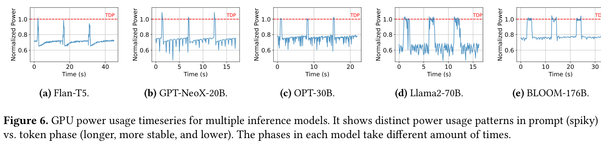
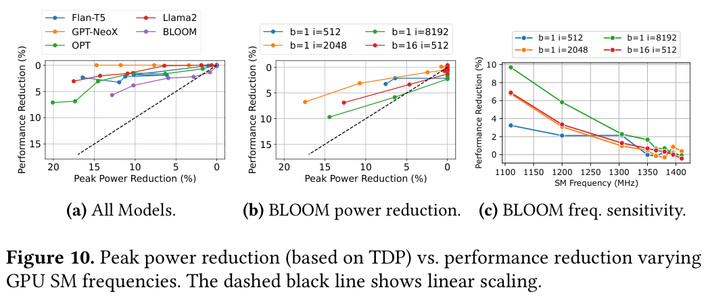
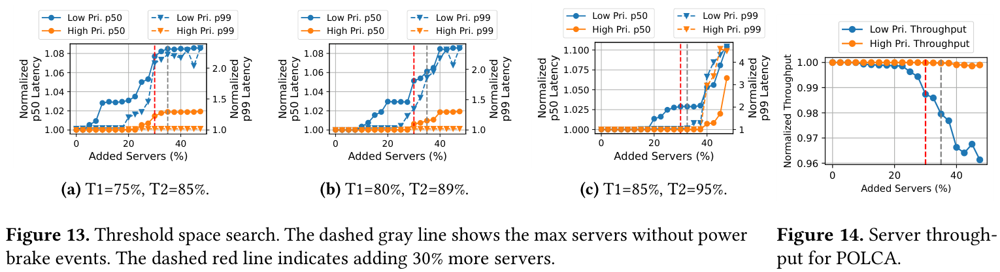
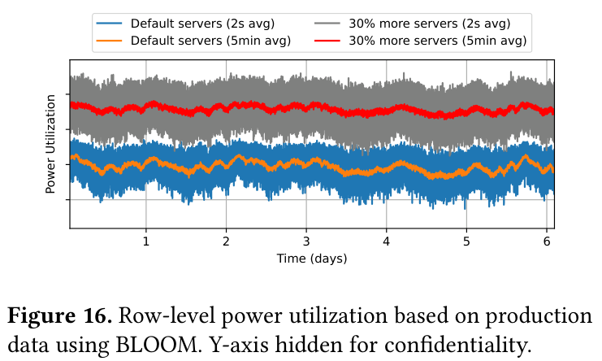
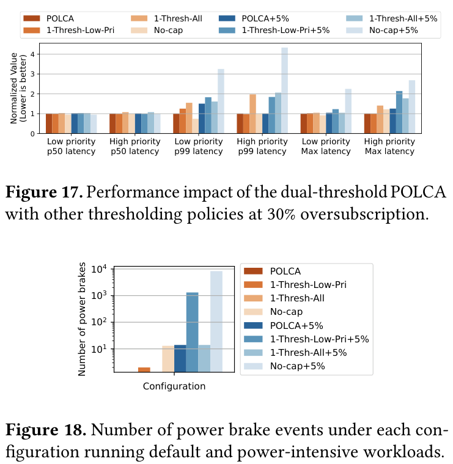

# POLCA: Characterizing Power Management Opportunities for LLMs in the Cloud

**Paper:** Pratyush Patel, Esha Choukse, Chaojie Zhang, Íñigo Goiri, Brijesh Warrier, Nithish Mahalingam, and Ricardo Bianchini. *Characterizing Power Management Opportunities for LLMs in the Cloud*. ASPLOS 2024. [Published paper](https://www.microsoft.com/en-us/research/uploads/prod/2024/03/GPU_Power_ASPLOS_24.pdf) · [DOI](https://doi.org/10.1145/3620666.3651329) · [Earlier POLCA preprint](https://arxiv.org/abs/2308.12908) · [Local PDF](polca/polca-asplos-2024.pdf)

This summary uses the expanded ASPLOS 2024 paper. Figures below are extracted from that version and retain their original numbering.

**POLCA addresses a capacity problem: how to install more inference servers in a datacenter whose electrical supply cannot grow.** It exploits unused power capacity, then selectively slows workloads when aggregate demand rises. Its headline result is **30% more servers within the existing power budget**, demonstrated in simulation informed by production measurements.

## The problem: provisioning every server for its worst case wastes capacity

A datacenter must accommodate simultaneous power demand without overloading its electrical infrastructure. Reserving each server’s maximum rated power is conservative, but inference often draws substantially less.

For example, suppose a hypothetical row has a 1 MW budget and each server is provisioned for 10 kW. Conventional provisioning allows 100 servers. Installing 130 becomes feasible if their combined demand usually stays below 1 MW—and a controller can reduce demand safely during exceptional peaks.

The crucial question is therefore **how much aggregate power can rise, how quickly it can rise, and how quickly the system can respond**.

## Why inference offers this opportunity

An inference request has two distinct phases:

- **Prefill**, called prompt processing in the paper: processes many input tokens together, producing a compute-intensive power peak.
- **Decode**, called token generation: generates tokens sequentially and is more constrained by memory bandwidth, often drawing less power for longer.

Figure 6 shows this across five models. The sharp peaks correspond to prompt processing; the lower stretches correspond to generation. Power is normalized to GPU thermal design power, or TDP.

Across independent requests, these peaks occur at different times. Consequently, the sum of individual maximum demands is larger than the maximum combined demand actually observed. This is **statistical multiplexing**.

Production measurements support the distinction: peak power utilization was **79% for inference versus 97% for training**. Training has synchronized computation across many GPUs, making its power peaks more correlated. These are observations from the studied clusters, not universal utilization constants. [Paper, §4.3 and Table 4](https://www.microsoft.com/en-us/research/uploads/prod/2024/03/GPU_Power_ASPLOS_24.pdf#page=8)

A useful calculation: if existing servers peak at 79% of the budget, scaling that demand proportionally suggests room for approximately `1 / 0.79 - 1 = 26.6%` more servers. That is intuition, not a safety guarantee; workload variation and control delays still matter.

## How POLCA controls the risk

POLCA measures aggregate power at the **row-level power distribution unit**, covering multiple racks. It uses workload priorities and two thresholds:

| Aggregate demand | Action in the evaluated configuration |
|---|---|
| Below 80% of provisioned power | Normal operation |
| Above 80% | Limit low-priority GPU clocks to 1,275 MHz |
| Above 89% | Further limit low-priority clocks to 1,110 MHz; if necessary, limit high-priority clocks to 1,305 MHz |
| Emergency | Apply a power brake, sharply reducing GPU frequency |

It restores clocks at lower thresholds to avoid repeatedly switching between throttled and unthrottled operation.

**Acting early is essential.** In the studied virtualized environment, ordinary out-of-band GPU controls could take **40 seconds**, whereas emergency power reduction needed to happen within **10 seconds**. POLCA therefore reserves room for demand to rise while its controls take effect. A faster, severe power brake provides the fallback. These timings describe the studied platform. [Paper, §§3 and 6.3](https://www.microsoft.com/en-us/research/uploads/prod/2024/03/GPU_Power_ASPLOS_24.pdf#page=10)

## Why slowing GPUs can be a favorable tradeoff

Figure 10 compares peak-power reduction with performance loss. The left panel compares models; the middle varies BLOOM’s request configuration; the right varies GPU frequency.

The paper reports operating points with **up to roughly 20% peak-power reduction for at most roughly 7% performance loss** across the evaluated models. The benefit varies by model and batch size. Memory-bound execution helps explain why reducing compute frequency need not cause a proportional slowdown. [Paper, §4.2](https://www.microsoft.com/en-us/research/uploads/prod/2024/03/GPU_Power_ASPLOS_24.pdf#page=8)

## The central result: 30% additional servers with bounded performance impact

Figures 13–14 show the capacity tradeoff. The horizontal axis is the percentage of additional servers. The red dashed line marks 30%; the middle panel uses POLCA’s selected 80%/89% thresholds.

At the selected configuration:

- **30% additional servers** meet the specified latency objectives.
- High-priority throughput remains essentially unchanged.
- Low-priority per-server throughput declines by **less than 2%**.
- The standard evaluation incurs **zero emergency power brakes**.

The latency objectives deserve attention:

| Allowed latency increase | High priority | Low priority |
|---|---:|---:|
| Median, p50 | <1% | <5% |
| Tail, p99 | <5% | <50% |

These are **acceptance limits**, not a table of measured increases. “Minimal impact” is most convincing for high-priority service and throughput; low-priority tail latency receives considerably more latitude. [Paper, §6 and Table 6](https://www.microsoft.com/en-us/research/uploads/prod/2024/03/GPU_Power_ASPLOS_24.pdf#page=12)

Figure 16 shows the resulting increase in power utilization. The additional servers consume previously unused capacity. The authors hide the numerical vertical scale for confidentiality, so this plot cannot establish absolute watts or exact headroom.

## Why the two thresholds matter

Figures 17–18 compare POLCA with simpler policies and repeat the experiment after increasing workload power consumption by 5%. Figure 17’s latency values are normalized to the standard POLCA result; Figure 18 counts emergency brakes on a logarithmic scale.

Early, moderate throttling of low-priority work helps prevent later, more disruptive intervention. POLCA preserves performance better than the simpler alternatives under the tested workload change. However, **the +5% power scenario does produce emergency brakes even with POLCA**; zero brakes is the standard-scenario result. [Paper, §6.6](https://www.microsoft.com/en-us/research/uploads/prod/2024/03/GPU_Power_ASPLOS_24.pdf#page=13)

## How strong is the evidence?

The characterization combines real GPU experiments and production power measurements. The **30% expansion is simulated**, using BLOOM-176B workloads constructed to reproduce a six-week production power trace within 3% mean absolute percentage error. One week tunes the policy; the following five evaluate it.

My interpretation is that the paper establishes a persuasive systems opportunity: **uncorrelated inference peaks plus selective throttling can turn unused electrical capacity into additional serving capacity**. Applying its numerical result elsewhere requires measuring the actual workload mix, batching behavior, priority distribution, and control delays. The reported gain concerns deployable server capacity; it does not establish a 30% reduction in energy per token.
