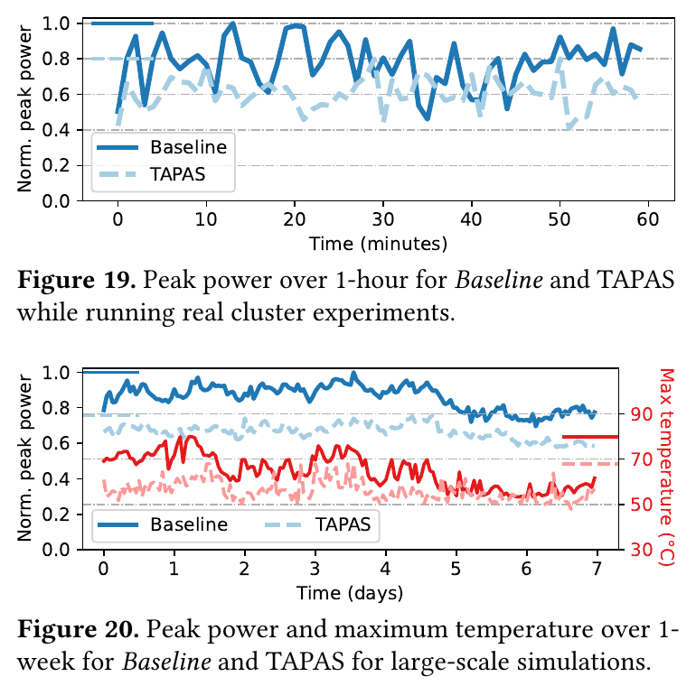
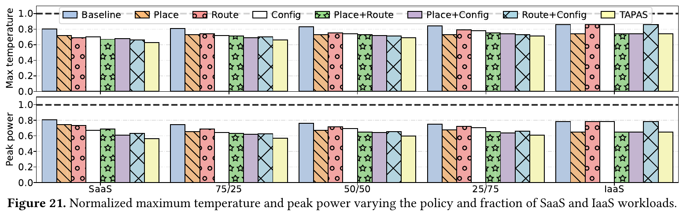
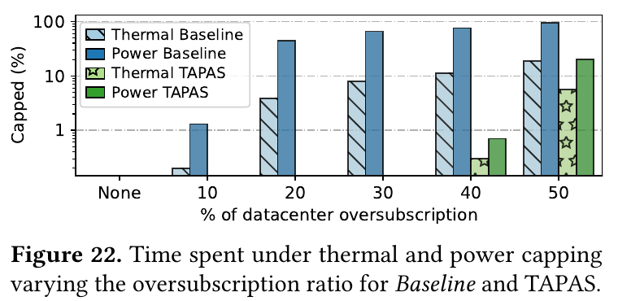

# TAPAS: Thermal- and Power-Aware Scheduling for LLM Inference in Cloud Platforms

Jovan Stojkovic et al., ASPLOS 2025.

[Published paper](https://iacomaweb.web.engr.illinois.edu/iacoma-papers/asplos25_2.pdf) · [Local PDF](tapas/tapas-asplos-2025.pdf) · [DOI](https://doi.org/10.1145/3676641.3716025)

**TAPAS turns spare power and cooling capacity into room for more GPU servers by coordinating where workloads run, where requests go, and how inference executes.** Its strongest result is **up to 40% more servers**, with thermal and power capping occurring less than **0.7% of the time** in its simulation.

It supplies much of the scheduling machinery needed to make an oversubscription strategy practical. The qualification is that its largest gains depend on the operator controlling a substantial fraction of the inference workloads.

## What problem is it solving?

A datacenter can have enough physical space for more GPUs while lacking the power delivery or cooling capacity to run all of them at their maximum simultaneously. Provisioning for that worst case leaves capacity unused much of the time. Adding servers—*oversubscription*—uses that capacity, but creates a risk of overloaded circuits, overheating, and throttling.

TAPAS addresses three complications:

- **The constraints are local.** A row can reach its power limit while another has spare capacity. A particular GPU can overheat even when total datacenter power is acceptable.
- **Demand changes over time.** Workloads peak at different times; outside temperatures and cooling conditions also vary.
- **The operator has unequal control.** Customer-managed GPU VMs, called **IaaS**, are largely opaque. Provider-managed inference services, called **SaaS**, allow request routing and configuration changes.

The opportunity is to use those controllable SaaS workloads to compensate for fluctuations elsewhere. For example, when customer workloads raise power consumption in one row, send new inference requests to replicas in another row with headroom. [Paper, §§2–3](https://iacomaweb.web.engr.illinois.edu/iacoma-papers/asplos25_2.pdf#page=3)

## How TAPAS works

It first builds empirical profiles relating workload intensity, server location, outside temperature, GPU temperature, airflow, and power. It also profiles the available inference configurations. Three components then act on those predictions:

| Component | What it decides | Why it helps |
|---|---|---|
| **VM placement** | Where to place each new workload | Avoids concentrating predicted power peaks and thermal hotspots. |
| **Request routing** | Which replica receives the next inference request | Moves incoming work toward available power and cooling capacity. |
| **Instance configuration** | How an inference instance runs | Reduces local demand when placement and routing cannot provide enough relief. |

Placement has a particularly useful policy: **reserve cooler servers for opaque IaaS workloads**, and place controllable SaaS workloads on warmer servers when safe. It also distributes SaaS capacity across rows so that each row has some workload the operator can adjust.

Routing checks three distinct constraints: **aisle airflow, row power, and server GPU temperature**. After excluding risky destinations, it applies conventional routing preferences such as cache reuse and performance.

Configuration adjusts GPU frequency, batch size, tensor parallelism, quantization, and model size. It seeks the best configuration meeting latency and infrastructure budgets; lower-quality model variants are a last resort. Changes requiring model reloads incur transition costs, which the controller accounts for. [Paper, §4](https://iacomaweb.web.engr.illinois.edu/iacoma-papers/asplos25_2.pdf#page=9)

One subtle point explains why these decisions need coordination: **reducing tensor parallelism can lower total server power while increasing the temperature of the hottest GPU**, because work becomes concentrated on fewer GPUs. A power-saving action can therefore make a thermal bottleneck worse. TAPAS profiles both dimensions, along with inference performance. [Paper, §3.3](https://iacomaweb.web.engr.illinois.edu/iacoma-papers/asplos25_2.pdf#page=8)

## What the main graphs show

The figures below are cropped from the **published ASPLOS version**; the preprint has different figure numbers.

### 1. Does it actually reduce peaks? Figures 19–20

In the **upper graph**, the solid line is the baseline and the dashed line is TAPAS. This is the one-hour cluster experiment, representing 80 A100 servers across two rows with a 50/50 IaaS–SaaS mix. The authors report **20% lower peak power utilization**, while maintaining latency targets and output quality. The experiment replays inference traces and uses historical power readings for IaaS workloads.

The **lower graph** extends the evaluation through a week of simulation using production traces. Blue shows power; red shows maximum GPU temperature. TAPAS reduces the reported peak power by **24%** and maximum temperature by **15%** in this experiment.

The practical benefit is the reduction in the highest peaks: those peaks determine how much infrastructure must be provisioned. These plots do **not** establish an equivalent percentage reduction in total energy consumption. [Paper, §§5.1–5.2](https://iacomaweb.web.engr.illinois.edu/iacoma-papers/asplos25_2.pdf#page=11)

### 2. Do all three components matter? Figure 21

The horizontal axis moves from **entirely provider-controlled SaaS** on the left to **entirely opaque IaaS** on the right. Each group compares placement, routing, configuration, their combinations, and full TAPAS. Lower bars are better.

At the central **50/50 mix**, full TAPAS reduces maximum temperature by **17%** and peak power by **23%** versus the baseline. Individual components help, but combining all three produces the largest reduction.

The workload mix matters:

- With **all SaaS**, reported reductions reach **23% for temperature and 28% for power**.
- With **all IaaS**, the available benefit comes from placement; request routing and inference reconfiguration are unavailable.

For a GPU rental business, this distinction is central: the full result assumes more control than simply renting customers opaque GPU servers. [Paper, §5.2](https://iacomaweb.web.engr.illinois.edu/iacoma-papers/asplos25_2.pdf#page=12)

### 3. How much oversubscription does this enable? Figure 22

This is the graph most directly relevant to power and cooling oversubscription.

The x-axis shows additional server capacity; the y-axis shows the percentage of time spent under thermal or power capping. **The y-axis is logarithmic.**

The baseline experiences substantial capping as oversubscription increases. TAPAS supports **40% more servers with thermal and power capping below 0.7% of the time**, without degrading output quality in that experiment. At **50% oversubscription**, its capping rises sharply too.

That supports a bounded claim: **TAPAS substantially expands the usable operating range, but does not eliminate capacity limits or guarantee zero throttling.** The paper also reports overall reductions of **97% in thermal throttling events and 99% in power throttling events**. [Paper, introduction and §5.3](https://iacomaweb.web.engr.illinois.edu/iacoma-papers/asplos25_2.pdf#page=12)

## What happens during failures?

The emergency experiments reduce available cooling capacity to **90%** or power capacity to **75%**. TAPAS redirects requests and changes inference configurations to accommodate those limits.

Here the trade-off changes: it protects performance partly by sending requests to smaller models. The reported SaaS quality impact is **−6% during the thermal emergency and −12% during the power emergency**. Thus, the normal-operation claim of preserving quality does not extend unconditionally to failures. [Paper, Table 2 and §5.4](https://iacomaweb.web.engr.illinois.edu/iacoma-papers/asplos25_2.pdf#page=12)

## Interpretation and relevance to a Fluidstack-style strategy

TAPAS provides strong evidence for **using inference scheduling to increase the number of servers supported by fixed infrastructure**. The limits of the evidence are also clear: the larger capacity results come from simulation; the main evaluation uses A100/Llama2 workloads and air-cooling models; and **40% more servers is neither a measured 40% throughput gain nor a 40% reduction in total ownership cost**.

For a Fluidstack-style oversubscription strategy, the key question is therefore: **does the operator control inference requests and runtime settings, or only VM placement and power caps?** TAPAS’s full advantage comes from controlling all three.

Figures: Stojkovic et al., ASPLOS 2025, [CC BY 4.0](https://creativecommons.org/licenses/by/4.0/), cropped from the paper.
